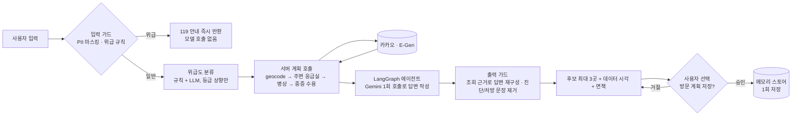

# ER Finder · 응급실 안내 에이전트

> 위치와 증상을 말하면 **근처 응급실의 실시간 병상·중증 수용 여부**를 근거와 함께 알려 주는 대화형 에이전트.
> LLM이 병원 정보를 지어내거나, 위급한 사람에게 검색부터 시키는 일을 **구조로 막는 것**이 이 프로젝트의 핵심입니다.

**키 없이 바로 체험** (샘플 데이터 · 실제 에이전트 그래프와 가드레일이 그대로 동작):

```bash
uv sync --frozen --extra dev
ER_DEMO=1 uv run --frozen python scripts/run_local.py     # PowerShell: $env:ER_DEMO=1
# → http://localhost:8503 · 사이드바 "에이전트 연결 확인" → 상담 탭에서 "37.4979, 127.0276 근처에서 발목이 아파요"
```


| 일반 검색 | 위급 입력(모델 호출 전 119 안내) | 승인 후 1회 저장 |
|---|---|---|
| [](docs/img/01-search.png) | [](docs/img/02-emergency.png) | [](docs/img/03-approval.png) |

> 화면은 `ER_DEMO=1` 샘플 데이터 기준입니다(병원은 가상).

## 해결하려는 문제와 접근

| 문제 | 접근 | 구현 |
|---|---|---|
| 위급한 사람에게 LLM 응답을 기다리게 하면 안 된다 | 위급 입력은 **모델 호출 전에** 119 안내로 단락 | `guardrails/input_guard.py`, `triage.py` (규칙 + LLM 분류기는 등급을 **올리기만**) |
| LLM이 없는 병원·병상을 말할 수 있다 | 모델이 낸 수치는 **채택하지 않고**, 모델 밖에 보관한 조회 근거로 답변을 재구성. 진단·처방성 문장은 제거 | `guardrails/evidence.py`, `middleware.py` (`EvidenceCheckMiddleware`) |
| 개인 정보·행동 | 저장은 **사람 승인 후 한 번만**(LangGraph interrupt/resume), 거절·중복·위치 변경 시 저장 안 함 | `agent/runner.py`, `memory/visit_plan.py` |
| 외부 API는 느리고 자주 실패한다 | 실패와 "정상적인 빈 응답"을 구분, 실패하면 추가 호출 중단, 캐시/강제 갱신을 화면에 표시 | `medical_api/`, `http_retry.py` |
| 아는 척하지 않기 | 확인 못 한 값은 "확인 불가", 정확도·임상 타당성은 **측정하지 않았다고 명시** | [알려진 한계](#알려진-한계) |

## 결과 (모두 재현 가능한 스크립트와 원본 JSON 포함)

| 지표 | 전 → 후 | 근거 |
|---|---|---|
| 검색 1회당 메인 모델 호출 | **5회 → 1회** (도구 호출 순서를 모델이 아니라 서버가 계획) | `ServerPlannedCalls`, [검증 1.2](docs/verification.md) |
| 응답 지연 (P50) | **약 21초 → 5~8초** (20회×3시나리오, 60/60 성공) | `docs/benchmarks/gemini-n20.json` |
| 턴당 비용 | 약 **$0.0025~0.0057** (단가는 가정값) | 같은 파일, `scripts/benchmark.py` |
| 위급도 규칙 정확도 (합성 골든셋 75건) | **85.9% → 96.9%**, 위급 재현율 **90% → 100%**, 오차단 0건 | `scripts/eval_golden.py`, [검증 1.4](docs/verification.md) |
| 오프라인 회귀 | 테스트 **426개 통과**, `ruff` · `mypy --strict` 통과, 외부 소켓 차단 상태에서 실행 | `scripts/verify.py` |

> 지연은 모델 교체와 서버 계획 호출 두 변화가 섞여 있어 효과를 분리하지 못했고(검증 문서에 명시), 같은 날 재측정에서는 P50이 6~10초로 나왔습니다(`gemini-remeasure.json`). 골든셋은 합성 자료이며 규칙을 이 사례에 맞춰 보강했으므로 일반화 성능이 아닙니다.

## 아키텍처



## 설계 결정과 이유

1. **도구 순서를 모델이 아닌 서버가 정한다.** 응급 검색은 단계가 고정이라 모델의 판단 여지가 없습니다. 모델은 마지막 답변 작성 1회만 맡아 지연·비용·변동성을 함께 줄였습니다.
2. **LLM 분류기는 등급을 올리기만 한다.** 규칙이 놓친 위급을 LLM이 보완하되, LLM이 규칙의 판단을 낮출 수 없어 과소 분류가 늘지 않습니다(실측: 위급 재현율 유지).
3. **안전 규칙은 프롬프트가 아니라 코드에 둔다.** 프롬프트 지시는 우회될 수 있으므로 입력 가드·출력 근거 재구성·승인 게이트를 미들웨어/그래프 구조로 구현했습니다.
4. **검증 증거를 구분한다.** 오프라인 테스트, 실제 API 실측, 합성 평가를 한 표에 섞지 않고 `integration.status`를 `NOT_VERIFIED`로 둡니다. 통과하지 않은 것을 통과했다고 쓰지 않기 위해서입니다.

## 데모 모드(`ER_DEMO=1`)의 범위

가상의 샘플 병원 5곳과 미리 정해진 모델 응답을 쓰며, 입력 가드·위급도 분류·서버 계획 호출·근거 검증·승인 흐름·메모리는 실제 코드가 그대로 실행됩니다. **실제 의료 정보가 아니며** 모델의 언어 능력은 시연하지 않습니다. '의료기관 조회' 탭은 E-Gen 키가 필요합니다. 배포 시에는 Streamlit Community Cloud에서 `streamlit_app.py`를 지정하고 Secrets에 `ER_DEMO = "1"`만 넣으면 키 없이 공개할 수 있습니다.

## 실행

Python 3.11 이상이 필요합니다. 프로젝트 루트에서 실행합니다.

```bash
uv sync --frozen --extra dev
uv run --frozen python scripts/run_local.py
```

로컬 확인 주소는 **http://localhost:8503**입니다. 이미 설치된 환경에서는 다음 명령으로 실행합니다.

```bash
.venv/bin/python scripts/run_local.py
```

이 실행기는 프로젝트 `.env`를 명시적으로 적용하므로 다른 작업에서 상속된 API 키가 우선하지 않습니다. 포트는 `--port 8504`처럼 바꿀 수 있습니다. 일반 `streamlit run` 또는 `er-finder` 실행은 기존 환경변수 우선순위를 유지합니다.

기존 `.env` 또는 실행 환경에 다음 키를 설정합니다. 필요한 항목은 [.env.example](.env.example)을 참고하세요. 화면은 키의 설정 여부만 표시하며 키 값을 출력하지 않습니다.

```dotenv
GEMINI_API_KEY=...
KAKAO_REST_API_KEY=... # 주소 검색을 사용할 때만 필요
EGEN_SERVICE_KEY=...
```

카카오 없이 상담하려면 왼쪽 **주소 검색 없이 좌표로 조회**를 체크하고 위도·경도를 지정한 뒤 **에이전트 연결 확인**을 누릅니다. **에이전트 상담** 탭에 증상을 입력합니다. 입력된 좌표가 실제 조회할 위치인지 확인하세요.

## 사용 흐름

| 탭 | 동작 |
|---|---|
| 의료기관 조회 | 좌표와 반경을 입력하고 조회하면 주변 기관 정보를 요청합니다. 기관명·거리·대표전화 등을 확인하고 기관을 선택해 상세 정보를 조회합니다. |
| 에이전트 상담 | 연결 확인 후 위치와 증상을 입력합니다. runner가 반환한 후보 선택과 방문 계획 승인·거절을 전달합니다. 연결 오류는 해당 상태로 표시합니다. |
| 연결 상태 | Gemini·카카오·E-Gen 키 설정 여부와 에이전트 연결 결과를 확인합니다. 설정됨은 API 인증 성공을 의미하지 않습니다. |

기관 목록은 병상이나 진료 수용 가능 여부의 확정 결과가 아닙니다. 누락된 정보는 확인 불가로 표시하며 방문 전에 병원 대표전화로 확인해야 합니다. 위급한 상황에서는 즉시 119에 연락하세요.

화면 재실행만으로 API를 다시 호출하지 않습니다. 새 대화는 대화와 승인 대기를 초기화하고, 기록 전체 삭제는 해당 브라우저의 저장 정보와 조회 기록도 제거합니다. 주소는 동의 후 저장하며, 방문 계획 저장은 병원 예약이나 접수가 아닙니다. 저장소는 서버 메모리이므로 영구 보관을 제공하지 않습니다.

## 검증

```bash
uv run --frozen python scripts/verify.py
uv run --frozen python scripts/verify.py --require-integration
```

검증 도구는 live 테스트를 제외하고 Python 소켓의 외부 통신을 차단합니다. 오프라인 검증은 실제 메모리·검색·LangGraph를 실행하며 모델과 HTTP 응답만 테스트 자료로 대체합니다. 별도의 화면 계약 테스트에는 주입한 runner를 사용합니다. 실제 키로 실행한 결과는 별도 로컬 보고서로 구분합니다. 수집 오류가 남으면 실행 가능한 테스트를 계속 기록하되 전체 결과는 FAIL입니다.

실제 API 실측과 품질 측정은 별도 명령이며 비용이 발생하므로 명시적으로만 실행합니다.

```bash
python scripts/benchmark.py --live --runs 20 --prices 0.25,2,0.15,0.6 --output docs/benchmarks/baseline.json
python scripts/benchmark.py --check docs/benchmarks/after.json     # 커밋 전 키·필수 항목 점검
python scripts/benchmark.py --compare docs/benchmarks/baseline.json docs/benchmarks/after.json
python scripts/eval_golden.py [--live]      # 위급도 골든셋(tests/fixtures/golden/triage.json)
ER_RUN_LIVE=1 pytest tests/live -m live     # 실제 E-Gen·Gemini 계약 점검(매일 CI에서도 실행)
```

`--prices`는 예시 값이 아니라 사용 중인 모델의 실제 단가(USD/1M 토큰)로 바꿔야 합니다. Windows에서 스크립트를 직접 실행할 때는 `PYTHONUTF8=1`을 설정하세요(테스트는 인코딩을 명시하므로 필요 없습니다). 상담 화면은 검색 단계(위치·병상·상세 확인)를 진행 상태로 보여 줍니다.

`verification-results/report.json`, `junit.xml`, `pytest.log`에 실행 근거를 저장합니다. 전체 연결을 검증하지 못하면 `integration.status`는 BLOCKED 또는 NOT_VERIFIED이며, 파일이 존재하거나 단위 테스트가 통과한 것만으로 통합 PASS를 표시하지 않습니다. 추천 정확도는 미측정이며, 지연 시간의 단일 실행 실측은 [검증 기록](docs/verification.md)을 따릅니다.

## 알려진 한계

- **임상 검증 없음.** 위급도 라벨은 합성 자료이며 의료진 검토를 받지 않았다. 추천의 임상적 적절성은 측정하지 않았다. 규칙 기반 분류의 오프라인 수치는 [검증 기록 1.4](docs/verification.md)를 따른다.
- **지연 시간.** 단일 실행 기준 검색에 약 15~21초가 걸린다(외부 API와 모델 호출 포함). 화면은 진행 중 표시만 제공한다.
- **영속성 없음.** 체크포인터와 프로필 저장소는 서버 메모리다. 위치 정보를 서버에 남기지 않는 설계 선택이며, 재시작하면 대화와 방문 기록이 사라진다. `ERFinder`는 `store`와 `checkpointer`를 주입받으므로 영구 저장소로 교체할 수 있으나, 개인정보 보관 정책을 먼저 정해야 한다.
- **중증외상 수용 여부는 확인하지 않는다.** E-Gen 중증질환 코드에 대응 항목이 없어 '확인 불가'로 표시한다.

## 담당과 문서

| 담당 | 경로 |
|---|---|
| 1 에이전트·공통 모델 | `agent/`, `models.py` |
| 2 의료 API | `medical_api/` |
| 3 위치·검색 | `search/` |
| 4 메모리 | `memory/` |
| 5 가드레일 | `guardrails/` |
| 6 화면·검증 | `web/`, `cli/`, `scripts/verify.py`, 화면 테스트 |

| 문서 | 내용 |
|---|---|
| [설계·계약](docs/design.md) | A 공통 인터페이스(데이터 모델·도구·Context·미들웨어·오류 처리), B E-Gen·카카오 API 매핑, C 화면↔runner 계약 |
| [검증](docs/verification.md) | 실행 기록, 검증 계획(성공 기준·시나리오·안전), 벤치마크 절차 |
| [포트폴리오 정리](docs/portfolio.md) | 역할, v2 기여, 이력서 문구, 면접 대비 |

CI는 `Web and verification tooling`(6번)과 `All modules integration`(전체)을 각각 실행합니다. 6번 통과를 전체 서비스 통과로 해석하지 않습니다. 로컬에서 담당 범위만 실행하려면 `python scripts/verify.py --scope web`을 사용합니다. 기본 실행은 전체 범위입니다. Windows에서도 `verify.py`가 동작하며(같은 프로세스의 loopback 연결만 허용), 외부 통신은 차단합니다.
