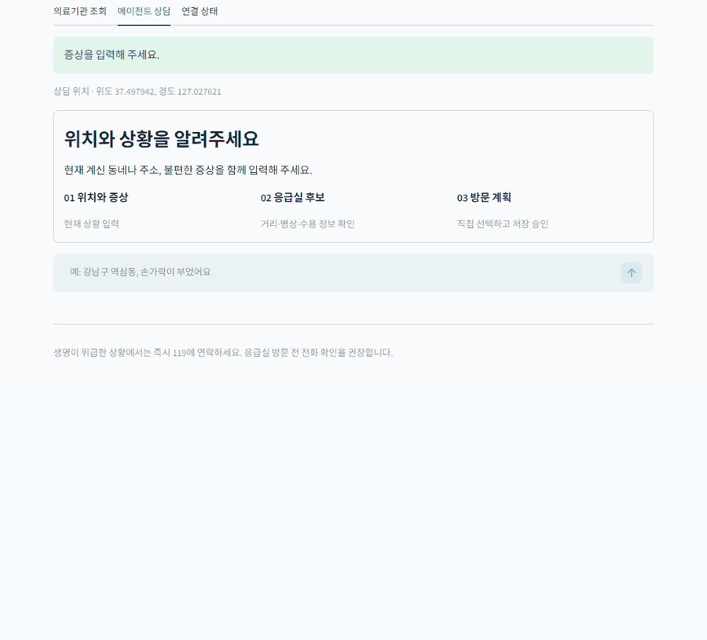
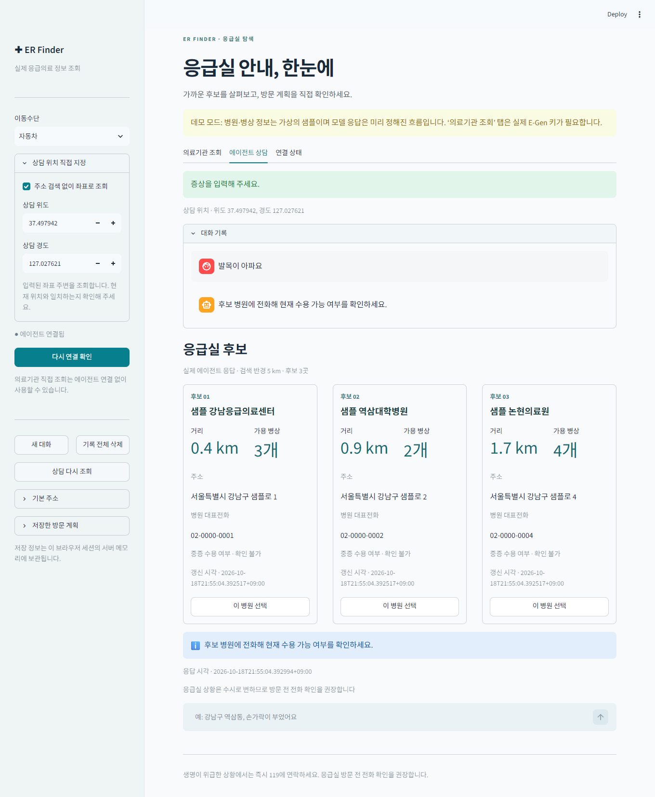
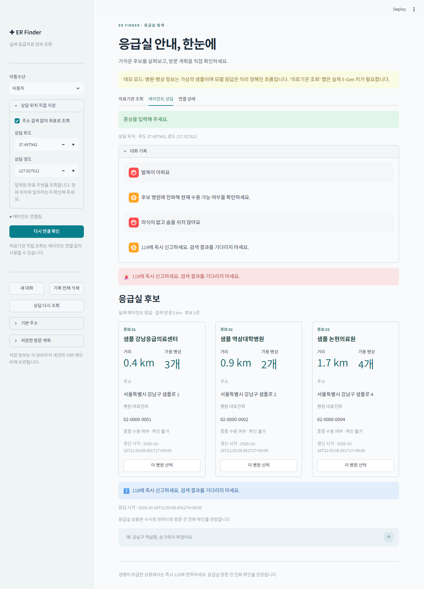
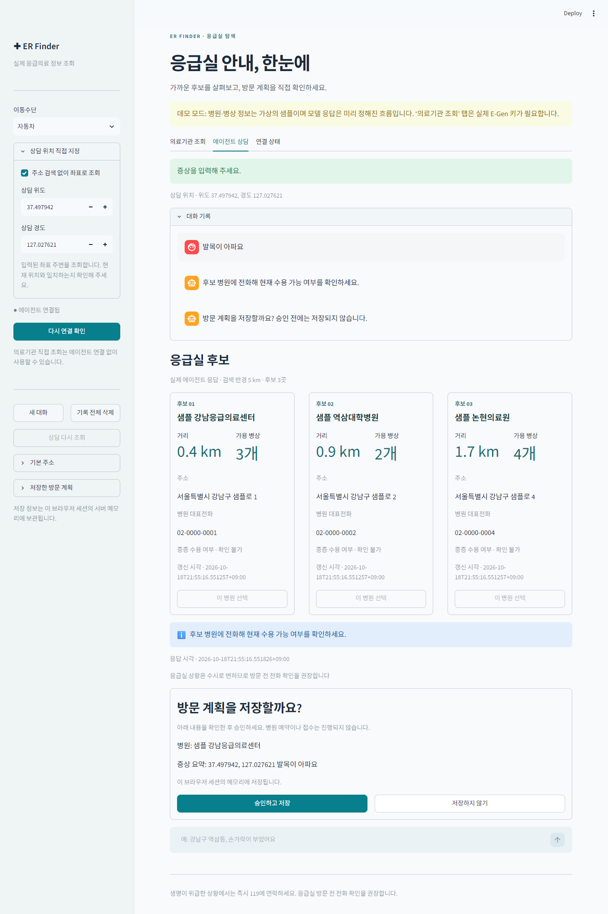
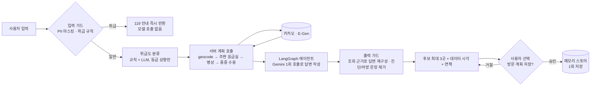

# ER Finder — 응급실 안내 LLM 에이전트

위치와 증상을 입력하면 근처 응급실의 실시간 병상·중증 수용 여부를 조회 근거와 함께 안내하는 대화형 에이전트.
위급 입력 처리, 답변 수치 검증, 저장 승인을 프롬프트 지시 대신 코드로 구현.

**6인 팀 프로젝트 → v2 통합·재설계 단독**

---

## Overview

- **Objective** : 위급 입력은 모델 호출 전에 119 안내, 일반 입력은 API 조회값으로 답변 작성
- **Method** : LangGraph 에이전트 + 서버가 정하는 도구 호출 순서 + 입력·출력 가드 미들웨어 + 승인 후 1회 저장(interrupt/resume)
- **Tools** : uv, Streamlit, Gemini, E-Gen 응급의료 API, 카카오 로컬 API, GitHub Actions



| 일반 검색 | 위급 입력(모델 호출 전 119 안내) | 승인 후 1회 저장 |
|---|---|---|
| [](docs/img/01-search.png) | [](docs/img/02-emergency.png) | [](docs/img/03-approval.png) |

> 화면은 `ER_DEMO=1` 샘플 데이터 기준입니다(병원은 가상).

## Features

- 규칙에 걸린 위급 입력은 모델 호출 없이 바로 119 안내 반환
- 위급도 LLM 분류기는 등급 상향만 가능
- 도구 호출 순서(위치, 주변 응급실, 병상, 중증 수용)는 서버가 결정하고 모델은 답변 작성에 1회 사용
- 결과가 없으면 반경을 3/5, 10, 20, 30km 순으로 확대, 조회 실패 시 추가 호출 중단
- 답변의 병원·병상 수치는 API 조회값으로 다시 작성, 진단·처방성 문장 제거
- 방문 계획은 사용자 승인 후 1회만 저장, 거절·중복 승인·위치 변경 시 저장 안 함
- 입력의 개인정보 마스킹, 확인 못 한 값은 "확인 불가" 표시
- API 키 없이 실제 그래프·가드레일이 도는 데모 모드(`ER_DEMO=1`, 가상 병원 5곳)
- 외부 소켓을 막은 상태로 전체 오프라인 테스트 실행, 실제 API 계약은 CI에서 매일 점검

## Tech Stack

- **Agent** : Python 3.11, LangGraph
- **LLM** : Gemini 3.5 Flash(답변 작성), Gemini 3.5 Flash-Lite(위급도 분류)
- **External API** : E-Gen 응급의료 API(XML), 카카오 로컬 API
- **Frontend** : Streamlit
- **Test · CI** : pytest, ruff, mypy --strict, GitHub Actions(`live-contract.yml`)

---

## Modules

| 모듈 | 역할 |
|---|---|
| `agent/` | LangGraph 그래프 조립(`graph.py`), 실행·승인 재개(`runner.py`), 진단(`diagnostics.py`) |
| `search/` | 호출 계획(`planner.py`), 반경 확대(`radius.py`), 답변 조립(`reply.py`), 위치 해석(`location.py`) |
| `medical_api/` | E-Gen 조회, 실패와 빈 응답 구분, 재시도(`http_retry.py`) |
| `guardrails/` | 입력 가드·위급 규칙(`input_guard.py`, `triage.py`), 근거 재구성(`evidence.py`), 개인정보 마스킹(`pii.py`) |
| `memory/` | 사용자 컨텍스트·세션·방문 계획 저장소(`visit_plan.py`) |
| `web/`, `cli/` | Streamlit 화면, 사용자 문구(`messages.py`) |

## Architecture



---

## Getting Started

키 없이 데모 실행 (가상 병원 데이터, 에이전트 그래프·가드레일은 실제 코드):

```bash
uv sync --frozen --extra dev
ER_DEMO=1 uv run --frozen python scripts/run_local.py   # PowerShell: $env:ER_DEMO=1
# http://localhost:8503 → "에이전트 연결 확인" → 상담 탭에 "37.4979, 127.0276 근처에서 발목이 아파요"
```


실제 API로 실행 (`.env`에 키 설정, 전체 항목은 [.env.example](.env.example)):

```dotenv
GEMINI_API_KEY=...
KAKAO_REST_API_KEY=...   # 주소 검색을 쓸 때만 필요
EGEN_SERVICE_KEY=...
```

```bash
uv run --frozen python scripts/run_local.py             # 프로젝트 .env 우선 적용, 포트 변경은 --port 8504
```

테스트 (외부 통신 차단, 키 불필요):

```bash
uv run --frozen python scripts/verify.py                         # 전체 범위
uv run --frozen python scripts/verify.py --require-integration   # 통합 검증 필수
```

실측·평가 (비용 발생, 명시적으로만 실행):

```bash
python scripts/benchmark.py --live --runs 20 --prices 0.25,2,0.15,0.6 --output docs/benchmarks/baseline.json
python scripts/benchmark.py --compare docs/benchmarks/baseline.json docs/benchmarks/after.json
python scripts/eval_golden.py [--live]
ER_RUN_LIVE=1 pytest tests/live -m live
```

`--prices`(USD/1M 토큰)는 예시 값이므로 실제 단가로 바꿔 실행. 상세: [설계·계약](docs/design.md), [검증](docs/verification.md)

---

## Results

| 지표 | 전 → 후 | 조건 |
|---|---|---|
| 검색 1회당 답변 모델 호출 | 5회 → 1회 | 위급도 분류(Flash-Lite) 호출은 별도 |
| 응답 지연 P50 | 약 21초 → 5.2~8.4초 | 개선 전 1회 실측 / 개선 후 강남역 좌표, 3시나리오 × 20회, 60/60 성공, 같은 날 재측정 6~10초 |
| 턴당 비용 | 약 $0.0025~0.0057 | 예시 단가로 계산한 추정치 |
| 위급도 규칙 정확도 | 85.9% → 96.9% | 합성 골든셋 75건 |
| 위급 재현율 | 90% → 100% | 같은 골든셋, 오차단 0건 |
| 규칙 + LLM 분류기 정확도 | 95.3% | 과대 분류 1건(`urg-09`) 증가, 과소 분류 증가 없음 |
| 승인 흐름 | 선택 → 거절 → 재선택 → 승인 → 중복 승인 | 저장 0 → 0 → 1 → 추가 없음 |
| 오프라인 회귀 | 테스트 426개 통과 | ruff · mypy --strict 통과, 외부 소켓 차단 |

근거: `docs/benchmarks/gemini-n20.json`, `gemini-remeasure.json`, `scripts/eval_golden.py`, `scripts/verify.py`

## Troubleshooting

| 단계 | 문제 | 해결 | 드러나는 역량 |
|---|---|---|---|
| 개인 | 모듈을 합치자 후보 근거 전달, 승인 후 재개, 위치 변경 시 이전 후보 처리가 맞지 않음 | LangGraph 에이전트 하나로 통합하며 모듈 간 계약 수정 | 모듈 간 계약 정리 |
| 개인 | 위급 입력도 검색과 모델 응답을 기다려야 함 | 입력 가드의 위급 규칙에 걸리면 모델 호출 없이 119 안내 반환 | 위급 입력 우선 처리 |
| 개인 | 모델이 도구 순서를 정해 검색 1회에 모델 5회 호출, 약 21초 | 호출 순서는 서버가 계획(`CallPlanner`), 모델은 답변 작성 1회. P50 5.2~8.4초 (모델 교체와 함께 바뀌어 효과 분리 못 함) | LLM 호출 범위 축소 |
| 개인 | 모델이 말한 병원·병상 수치를 사용자가 확인할 수 없음 | 답변 수치를 API 조회값으로 다시 작성, 진단·처방 문장 제거 | 환각 차단 |
| 개인 | 규칙이 위급 사례를 놓침 (재현율 90%) | 놓친 사례로 규칙 보강, LLM 분류기는 등급 상향만 허용. 재현율 100%, 정확도 95.3% (과대 분류 1건) | 과소 분류 방지 |
| 개인 | 거절·중복 승인·위치 변경 뒤에도 방문 계획이 저장될 수 있음 | interrupt/resume로 승인 후 1회만 저장 | 저장 시점 통제 |
| 개인 | 외부 API 실패와 정상적인 빈 응답이 구분되지 않음 | 실패면 추가 호출 중단, 캐시 상태 화면 표시 | 실패·빈 응답 구분 |
| 개인 | 491줄 `search/service.py`에 호출 계획·답변 조립·위치 해석이 섞임 | `planner.py`·`reply.py`·`location.py`로 분리, `runner.py`에서 `graph.py`·`diagnostics.py` 분리 | 모듈 분리 |
| 개인 | 오프라인 테스트 통과가 통합 통과로 읽힐 수 있음 | 오프라인·실제 API·합성 평가 결과 분리, 오프라인만 통과하면 `integration.status=NOT_VERIFIED` | 검증 결과 구분 |

## Limitations

- 위급도 라벨이 합성 자료이고 의료진 검토 없음, 임상 적절성·추천 정확도 미측정 → 의료진 검토 라벨과 추천 평가셋
- 지연 개선에 모델 교체(OpenAI → Gemini)와 서버 계획 호출이 섞임 → 같은 모델로 호출 방식만 바꿔 재측정
- 측정 위치(강남역)와 시간대가 각각 한 곳 → 지역·시간대 확대 측정
- 골든셋에 맞춰 규칙을 보강해 일반화 성능 아님 → 보강에 쓰지 않은 별도 평가셋
- 체크포인터·저장소가 서버 메모리라 재시작 시 소멸 → 보관 정책을 정한 뒤 영구 저장소 주입(`store`, `checkpointer`)
- E-Gen에 중증외상 대응 코드가 없어 "확인 불가" 표시 → 대응 데이터 출처 확보

---

## Contributors

| 단계 | 담당 |
|---|---|
| 1단계 (팀) | `memory/` 모듈 — 사용자 컨텍스트·세션·방문 계획 저장소 (PR #1) |
| 2단계 (개인, `v2/refactor` PR #1) | 전체 통합, 안전 가드레일 재설계, 서버 계획 호출, 위급도 골든셋·벤치마크·API 계약 CI, 리팩터링, 데모 모드 |
